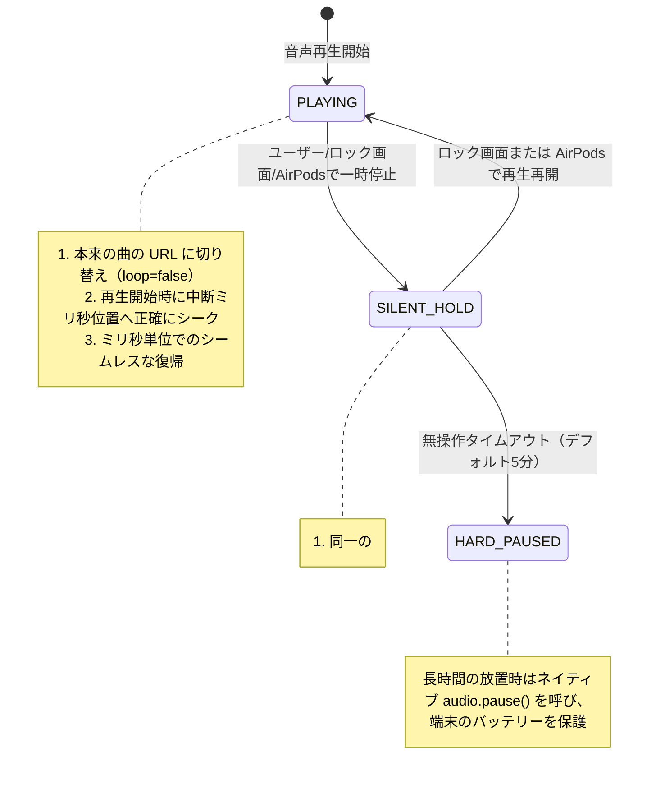

# 🎧 PWA Player (`@pwa-player/core`)

> **クロスフレームワーク対応 PWA オーディオエンジン** — iOS WebKit / Mobile Safari 特有のスリープ時プログレス停止（擬似シーク固まり）、ハードウェアデコーダ破棄、アートワーク消失、AirPods 操作の反転ループを根本から解決します。

<p align="center">
  <a href="./README.md"><b>English</b></a> |
  <a href="./README.zh-CN.md"><b>简体中文</b></a> |
  <a href="./README.ja.md"><b>日本語</b></a>
</p>

[](LICENSE)
[](https://pwa-audio-player.pages.dev)
[](#framework-demos)
[](#core-architecture)

---

## 💡 PWA Player が解決する課題

iOS の Safari やホーム画面追加後の PWA（Standalone）環境で、標準の HTML5 `<audio>` を使ってバックグラウンド再生を行う際、以下のような**システム起因の制約**に直面します：

| 現象 | 発生条件 | システム内部の根本原因 | 通常のプレイヤーの挙動 | PWA Player（単一無音キープ方式） |
| :--- | :--- | :--- | :--- | :--- |
| **スリープ復帰時の固まり (プログレス停止)** | ロック画面で一時停止後、15秒以上放置してから再開 | 省電力のため、iOS が該当 `<audio>` の **CoreAudio デコーダ枠**を破棄する | バーだけ空進みし、時間は静止、音が出ない | **✅ タップ直後にミリ秒単位で瞬時復帰** |
| **アートワークの消失** | 一時停止時に `muted = true` を適用する | WebKit の `canShowControlsManager()` が消音状態を弾き、NowPlaying 権限を剥奪する | ロック画面から操作カードが消える | **✅ メタデータと画像を常に画面に保持** |
| **AirPods 操作の不整合** | AirPods の軸タップで一時停止・再生を繰り返す | バックグラウンド無音再生中、iOS のデーモンが逆方向の `action: "pause"` を誤発行する | タップしても無反応、または停止ループに陥る | **✅ Flip-Flop 状態遷移によるスムーズな再開** |
| **曲送り時の停止** | 自動遷移またはロック画面からの曲スキップ | 非同期の `fetch()` 処理を挟むことで、**ユーザー操作コンテキスト（User Gesture）**が失われる | 画面表示は変わるが無音のまま停止する | **✅ 前後トラックの先行プリロードで同期切り替え** |
| **15秒スキップボタンへの変形** | `timeupdate` での高頻度な位置更新 | IPC 通信の過密により、ロック画面が標準の `«15 15»` スキップ表記に強制初期化される | 前後スキップボタンが消える | **✅ イベント間引きにより標準 ⏮ ⏯ ⏭ を維持** |

---

## 🛡️ コアアーキテクチャ：単一トラック無音キープ（Single-Track Silent Hold）

### 2系統オーディオや Web Audio 方式が機能しない理由
- iOS は `HTMLMediaElement` インスタンスごとに独立したデコーダ枠を割り当てます。主音声側で `audio.pause()` を呼ぶと、副音声が鳴っていても主音声側のデコーダは数秒で回収されます。
- Web Audio API（`AudioContext`）は、画面消灯から数秒で WebKit によって強制サスペンドされます。

### PWA Player の解決策
同一の `<audio>` インスタンスで**決して `pause()` を呼びません**：



---

## 🎮 デモ一覧（Framework Demos）

`examples/` ディレクトリに、各フレームワーク専用テーマを適用した検証用デモを収録しています：

- **Hub（デモ一覧）** (`:5170`): 各デモへの案内と動作検証ガイド。
- **Vanilla TS** (`:5173`): アンバーゴールド。外部依存なしの純粋な DOM 実装。
- **React 18 / 19** (`:5174`): スカイブルー。カスタムフック `usePwaPlayer` 搭載。
- **Vue 3** (`:5175`): エメラルドグリーン。`shallowRef` を用いた Composable 実装。
- **Svelte 5** (`:5176`): フレイムオレンジ。Svelte 5 Runes（`$state`, `$derived`）による最新実装。

### ローカルでの起動方法
```bash
git clone https://github.com/ajaxsys/pwa-player.git
cd pwa-player
pnpm install
pnpm dev:demos
```
PC と同じ Wi-Fi に接続した iPhone から、ターミナル上に表示される QR コードを読み取るだけで実機テストが可能です。

---

## 🚀 クイックスタート

### インストール
```bash
npm install @pwa-player/core
# または
pnpm add @pwa-player/core
```

### 基本的な実装（TypeScript / Vanilla）
```typescript
import { createPwaPlayer } from '@pwa-player/core';

const player = createPwaPlayer({
  initialQueue: [
    {
      id: 1,
      title: 'Neon Horizon',
      artist: 'Synthwave Echoes',
      album: 'Cyber Odyssey',
      src: 'https://example.com/audio1.mp3',
      artwork: 'https://example.com/cover1.jpg',
      duration: 180,
      lrc: '[00:00.00]イントロ開始...'
    }
  ],
  keepAlive: {
    strategy: 'auto',              // iOS では無音キープを有効化、その他は通常停止
    hardPauseTimeoutMs: 5 * 60 * 1000 // 5分間の放置で省電力完全停止へ移行
  },
  preloadAdjacent: true,           // 前後曲を先読みし、iOS の操作権限を維持
  enableLockscreenLyrics: true     // ロック画面の MediaSession と歌詞を同期
});

// 操作
player.play();
player.toggle();
player.next();

// 状態の購読
const unsubscribe = player.subscribe((state) => {
  console.log('再生状態:', state.playbackState, '現在時間:', state.currentTime);
});
```

---

## 📱 iOS 実機での検証手順

1. iPhone の Safari で曲を再生し、電源ボタンを押して画面をロックします。
2. ロック画面に高解像度のアートワーク、同期歌詞、スキップボタンが表示されていることを確認します。
3. ロック画面や AirPods で一時停止し、20〜30秒間そのまま放置して深いスリープに入れます。
4. 再度再生をタップ：秒針が固まることなく、瞬時に音が鳴り始めます。
5. 曲を自然に最後まで聴き、画面消灯下でも自動で次の曲へ進むことを確認してください。

---

## 📄 ライセンス

MIT License © 2026 [ajaxsys](https://github.com/ajaxsys)

