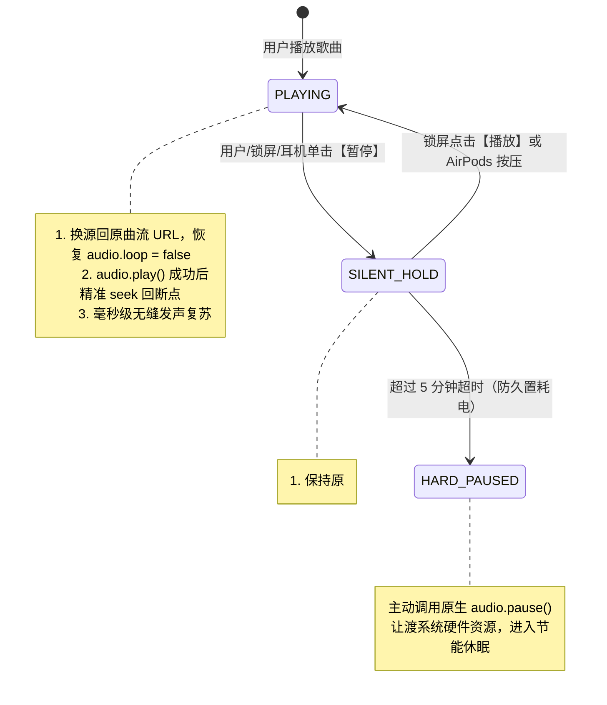

# 🎧 PWA Player (`@pwa-player/core`)

> **跨框架通用 PWA 音频播放器内核** — 彻底根治 iOS WebKit / Mobile Safari 锁屏后台暂停假走针死锁、硬件解码器回收、静音封面蒸发与 AirPods 反向按压难题。

[](LICENSE)
[](#examples)
[](#core-architecture)

---

## 💡 为什么需要 PWA Player？

在 iOS Mobile Safari 和 PWA（独立全屏模式 Standalone）中，使用标准 HTML5 `<audio>` 播放音乐一直存在几个令 Web 开发者痛苦万分的**系统级深水区顽疾**：

| 顽疾现象 | 触发场景 | 底层系统根因 | 传统播放器表现 | PWA Player (单轨静音保活) |
| :--- | :--- | :--- | :--- | :--- |
| **假走针死锁 (Fake Progress)** | 锁屏暂停超过 5~15 秒后再按播放 | iOS 为节电在 3~5 秒后单方面注销并回收该 `<audio>` 绑定的底层 **CoreAudio PCM 硬件解码槽** | UI 进度条往前空跑，耳机无声，`currentTime` 冻结 | **✅ 毫秒级瞬时出声恢复** |
| **锁屏封面歌名蒸发** | 暂停时使用 `muted = true` 试图软暂停 | WebKit 源码 `canShowControlsManager()` 命中静音硬拦截，当场剥夺 NowPlaying 资格 | 锁屏卡片直接消失被 Apple Music 顶替 | **✅ 保持原曲 Metadata 钉死不丢** |
| **AirPods 按压唤醒失效** | 耳机按压单击暂停后再按压播放 | 底层有发声流时，iOS 守护进程倾向下发反向 `action: "pause"` 导致死循环 | 怎么按都没有反应或越按越死 | **✅ 智能翻转状态机（Flip-Flop）顺滑唤醒** |
| **切歌/连播死锁** | 播放完自动下一首或锁屏点切歌 | 切歌时若经过 `await fetch()` 异步网络请求，**用户手势信任链（User Gesture Context）**瞬间失效，系统抛出 `NotAllowedError` | 锁屏切歌看似切了但完全无声 | **✅ 双向周边并发预热，零异步同步切换** |
| **锁屏跳秒键冲刷** | 熄屏控制中心 | 在 `timeupdate` 中每秒多次调用 `setPositionState`，导致跨进程 IPC 冲刷使系统重置回 `«15 15»` 跳秒布局 | 锁屏只能跳 15 秒，没有上一首/下一首 | **✅ 显式封死跳秒，低频事件驱动原生 ⏮ ⏯ ⏭ 音乐布局** |

---

## 🛡️ 核心技术架构：单轨静音换源保活 (Single-Track Silent Hold)

### 1. 为什么“双音轨”或“Web Audio 振荡器”不管用？
- iOS 会为每一个独立的 `HTMLMediaElement` 实例分配专属的硬件解码通道。一旦主音频元素调用了 `audio.pause()`，即使副音轨在播放声音，主音轨对应的 CoreAudio 硬件解码器依然会在数秒后被系统单方面销毁；
- Web Audio API (`AudioContext`) 在屏幕熄灭数秒后会被 WebKit 强行挂起（`state -> suspended`）。

### 2. PWA Player 的解决方案
保持**同一个 `<audio>` 实例永不调用 `pause()`**：



---

## 📦 项目结构

```
~/dev/pwa-player/
├── packages/
│   └── core/                     # @pwa-player/core (纯 TypeScript，零外部框架依赖)
│       ├── src/
│       │   ├── player.ts         # PwaPlayer 统一核心调度器与不可变状态缓存
│       │   ├── keepAlive.ts      # 单轨静音换源保活与三重隐形锁 (SilentHoldKeeper)
│       │   ├── mediaSession.ts   # MediaSession 规范化与锁屏沉浸歌词
│       │   ├── playlist.ts       # 播放列表状态机 (loop / sequence / single / shuffle)
│       │   ├── gesture.ts        # 双向周边曲目并发预热 (保护 iOS 手势信任链)
│       │   ├── lyric.ts          # LRC 歌词解析与 Diff 增量节流
│       │   └── silentWav.ts      # 内存 2s 0 振幅静音 PCM WAV 发生器
│       └── dist/                 # 已构建就绪的 ESM / CJS / d.ts
├── demo-assets/                  # 3 首自带免版权纯前端音乐 (无需任何后台，纯离线可用)
│   ├── track1.wav                # Neon Horizon (12s, 8小节合成器琶音)
│   ├── track2.wav                # Morning Mist (14s, Lo-Fi 氛围)
│   ├── track3.wav                # Starlight Serenade (12s, 星空清脆八音盒)
│   ├── cover1~3.svg              # 3 张对应的高清 SVG 封面
│   └── demoTracks.ts             # 包含 LRC 歌词与静态模块导出的示例曲库清单
└── examples/                     # 4 大主流框架独立演示 Demo (带控制台 ASCII 二维码)
    ├── vanilla/                  # 纯原生 Vanilla JS / TS Demo
    ├── react/                    # React 18 / 19 Demo (附带自定义 usePwaPlayer Hook)
    ├── vue/                      # Vue 3 Demo (附带 shallowRef 组合式 API Composable)
    └── svelte/                   # Svelte 5 Demo (附带 Runes $state / $derived 状态)
```

---

## 🚀 快速使用

### 1. 核心安装
```bash
npm install @pwa-player/core
# or
pnpm add @pwa-player/core
```

### 2. 纯 Vanilla TS 使用
```typescript
import { createPwaPlayer } from '@pwa-player/core';

const player = createPwaPlayer({
  initialQueue: [
    {
      id: 1,
      title: 'Neon Horizon',
      artist: 'Synthwave Echoes',
      src: 'https://example.com/song1.mp3',
      artwork: 'https://example.com/cover1.jpg',
      duration: 180
    }
  ],
  keepAlive: {
    strategy: 'auto',              // iOS 自动激活静音保活，桌面/Android 原生 pause
    hardPauseTimeoutMs: 5 * 60 * 1000 // 5 分钟超时自动真暂停节能
  },
  preloadAdjacent: true,           // 双向预热前后曲目，杜绝切歌 NotAllowedError
  enforceTrackNavigation: true,    // 封死 15s 跳秒，维持原生音乐控制卡片
  enableLockscreenLyrics: true     // 锁屏实时滚动歌词
});

// 状态订阅 (具有引用一致性，并发安全)
player.subscribe((state) => {
  console.log(state.currentTrack, state.isPlaying, state.currentTime);
});

// 播控方法
player.toggle();
player.next();
player.prev();
player.seek(15.5);
```

### 3. React 18 / 19 (`usePwaPlayer`)
```tsx
import { usePwaPlayer } from './usePwaPlayer';

export default function MusicPlayer() {
  const { state, toggle, next, prev, seek } = usePwaPlayer({
    initialQueue: myTracks,
    keepAlive: { strategy: 'auto' }
  });

  return (
    <div>
      <h3>{state.currentTrack?.title}</h3>
      <button onClick={toggle}>{state.isPlaying ? '暂停' : '播放'}</button>
      <button onClick={next}>下一首</button>
    </div>
  );
}
```

---

## 🧪 启动本地 Demo 进行测试

本仓库自带免版权测试音乐（每首约 12~14 秒，无需等待数分钟即可快速验证自动连播与锁屏交互）：

```bash
cd ~/dev/pwa-player

# 1. 运行全部自动化单体测试
pnpm test

# 2. 一键并发启动全部框架 Demo 与主导航中心：
pnpm dev:demos     # 启动导航中心 (5170) 及 4 大框架 Demo (5173~5176)

# 3. 或单独启动某个框架 Demo：
pnpm dev:vanilla   # 纯原生 TS Demo   -> http://localhost:5173
pnpm dev:react     # React 18/19 Demo -> http://localhost:5174
pnpm dev:vue       # Vue 3 Demo       -> http://localhost:5175
pnpm dev:svelte    # Svelte 5 Demo    -> http://localhost:5176
```

### 📱 手机 Safari 扫码测试：
- 控制台启动后会打印出字符二维码；
- 打开手机相机对准终端屏幕一扫即可打开；
- 能够秒出封面和声音，且在黑屏静置 20~30 秒后再次按播放瞬间恢复出声！

---

## 📄 License
MIT © 2026 PWA Player Contributors
