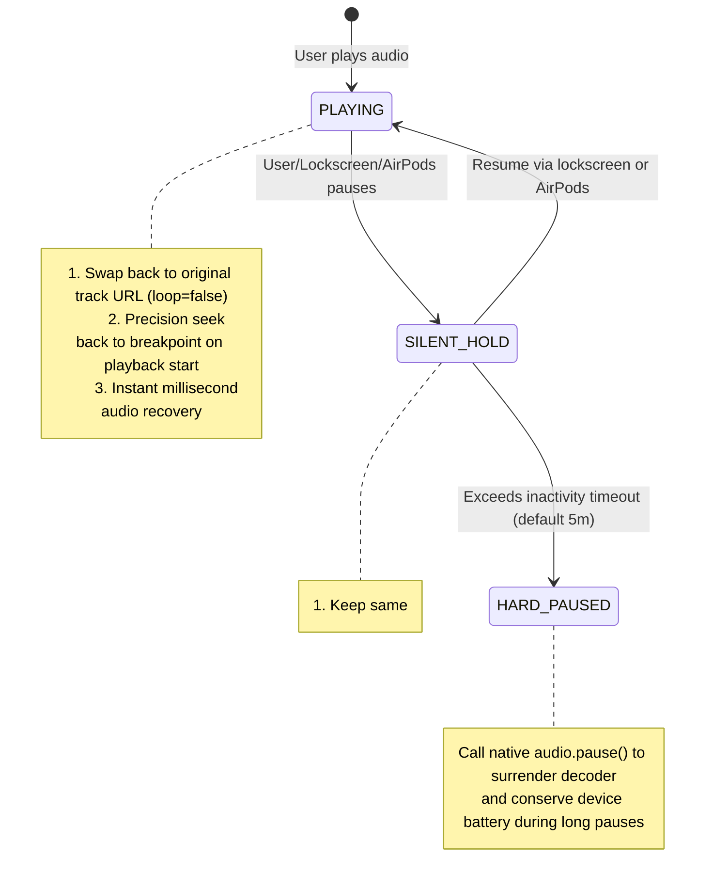

# 🎧 PWA Audio Player (`pwa-audio-player`)

> **Universal PWA & Web Audio Engine** — Eliminates iOS WebKit lockscreen freeze-lock deadlocks, hardware decoder eviction, artwork disappearance, and AirPods pause/resume loops.

<p align="center">
  <a href="./README.md"><b>English</b></a> |
  <a href="./README.zh-CN.md"><b>简体中文</b></a> |
  <a href="./README.ja.md"><b>日本語</b></a>
</p>

[](LICENSE)
[](https://www.npmjs.com/package/pwa-audio-player)
[](https://pwa-audio-player.pages.dev)
[](#framework-demos)
[](#core-architecture)

---

## 💡 Why PWA Audio Player?

On iOS Mobile Safari and standalone PWAs, using HTML5 `<audio>` for lockscreen playback has long been plagued by low-level WebKit quirks and CoreAudio power-saving behaviors:

| Pitfall | Trigger Scenario | Underlying Cause | Typical Player Behavior | PWA Player (Single-Track Silent Hold) |
| :--- | :--- | :--- | :--- | :--- |
| **Freeze-Lock Deadlock** | Paused on lockscreen for >15 seconds, then resume | iOS evicts the underlying **CoreAudio hardware decoder slot** to save power | Progress bar advances silently; time is frozen; no audio output | **✅ Instant millisecond audio recovery** |
| **Artwork Eviction** | Using `muted = true` for soft pauses | WebKit `canShowControlsManager()` strips NowPlaying privileges on mute | Lockscreen card disappears or is replaced by Apple Music | **✅ Metadata and artwork pinned permanently** |
| **AirPods Click Failures** | Pausing and resuming via AirPods stem click | During silent streams, iOS daemon emits inverted `action: "pause"` events | Taps are ignored or trigger pause-pause loops | **✅ Flip-Flop state machine for smooth wake-up** |
| **Track-Switch Stalls** | Auto-advancing tracks or skipping on lockscreen | Asynchronous `fetch()` calls invalidate the **User Gesture Context** | Track changes on UI but remains completely silent | **✅ Bidirectional adjacent preloading with sync switches** |
| **Seek Button Scrubbing** | Frequent calls in `timeupdate` | IPC flooding causes iOS to reset lockscreen controls to `«15 15»` seek buttons | Lockscreen loses prev/next track buttons | **✅ Enforces native ⏮ ⏯ ⏭ controls with event throttling** |

---

## 🛡️ Core Architecture: Single-Track Silent Hold

### Why don't dual-audio or Web Audio oscillators work?
- iOS assigns separate hardware decoder channels to distinct `HTMLMediaElement` instances. Calling `audio.pause()` on the primary element still causes CoreAudio to evict that channel after a few seconds.
- Web Audio API (`AudioContext`) is suspended by WebKit seconds after the display turns off.

### The Solution: Keep the Same Element Alive


---

## 🎮 Framework Demos

A unified test suite is available under `examples/` with dedicated framework themes:

- **Hub Overview** (`:5170`): Cross-framework navigation and mobile testing guide.
- **Vanilla TS** (`:5173`): Pure DOM implementation, zero dependencies.
- **React 18 / 19** (`:5174`): Features the `usePwaPlayer` custom hook.
- **Vue 3** (`:5175`): Features the `usePwaPlayer` Composable with `shallowRef`.
- **Svelte 5** (`:5176`): Built on modern Svelte 5 Runes (`$state`, `$derived`).

### Running Demos Locally
```bash
git clone https://github.com/ajaxsys/pwa-audio-player.git
cd pwa-audio-player
pnpm install
pnpm dev:demos
```
Open `http://localhost:5170` or scan the terminal QR code with your iPhone on the same Wi-Fi.

---

## 🚀 Quick Start

### Installation
```bash
npm install pwa-audio-player
# or
pnpm add pwa-audio-player
```

### Basic Usage (TypeScript / Vanilla)
```typescript
import { createPwaPlayer } from 'pwa-audio-player';

const player = createPwaPlayer({
  initialQueue: [
    {
      id: 1,
      title: 'Neon Horizon',
      artist: 'Synthwave Echoes',
      album: 'Cyber Odyssey',
      src: 'https://example.com/audio1.mp3',
      artwork: 'https://example.com/cover1.jpg',
      duration: 180,
      lrc: '[00:00.00]Synthesizer starts...'
    }
  ],
  keepAlive: {
    strategy: 'auto',              // iOS enables silent-hold, other platforms standard pause
    hardPauseTimeoutMs: 5 * 60 * 1000 // Deep battery-saving pause after 5 minutes
  },
  preloadAdjacent: true,           // Safeguards user-gesture activation chain
  enableLockscreenLyrics: true     // Synchronizes lyrics to lockscreen MediaSession
});

// Controls
player.play();
player.toggle();
player.next();

// State subscription
const unsubscribe = player.subscribe((state) => {
  console.log('Playback state:', state.playbackState, 'Current time:', state.currentTime);
});
```

---

## 🧩 Modular Toolchain & Standalone Recipes

Don't need the monolithic player? Every primitive in `pwa-audio-player` is **tree-shakeable** and can be integrated into your existing player architecture (React, Vue, Svelte, Redux, Zustand, Pinia, or vanilla audio elements):

### 1. ⏱️ Drift-Free Sleep Timer (`SleepTimerController`)
Maintains precise wall-clock countdowns even under aggressive iOS background timer throttling, with an "End of current track" mode and complete hardware resource release.

```typescript
import { SleepTimerController } from 'pwa-audio-player';

const timer = new SleepTimerController({
  onTimerEnd: () => {
    // Teardown playback & release audio decoder
    audioElement.pause();
    console.log('Playback paused to save battery');
  },
  onTick: (remainingSeconds) => {
    console.log(`Time remaining: ${remainingSeconds}s`);
  }
});

// Set 30-minute timer
timer.setPreset(30);

// Or stop after the currently playing song finishes
timer.setEndOfTrack(true);

// Sync with playback updates to calibrate against background drift
audioElement.addEventListener('timeupdate', () => {
  timer.checkTick();
});
```

### 2. 🌐 Service Worker Range 206 Stream Slicing (`swAudio`)
Eliminates the iOS Safari lockscreen seek deadlock when serving cached audio through a Service Worker:

```javascript
// In your sw.js
import { createPartialResponse, isAudioRequest } from 'pwa-audio-player';

self.addEventListener('fetch', (event) => {
  if (isAudioRequest(event.request.url)) {
    event.respondWith((async () => {
      const cache = await caches.open('my-audio-cache');
      const cached = await cache.match(event.request);
      if (cached) {
        const rangeHeader = event.request.headers.get('Range');
        // Synthesizes a valid 206 Partial Content Response with Content-Range headers
        return createPartialResponse(cached, rangeHeader);
      }
      return fetch(event.request);
    })());
  }
});
```

### 3. 💾 Offline Audio Cache Manager (`AudioCacheStorage`)
A complete browser CacheStorage audio stream manager with storage quota detection and play count analytics:

```typescript
import { AudioCacheStorage, queryStorageQuota } from 'pwa-audio-player';

const audioCache = new AudioCacheStorage({
  cacheName: 'app-audio-v1',
  storageKeyPrefix: 'my_app_audio_'
});

// Cache a remote audio stream for offline playback
await audioCache.cacheTrack('track_101', 'https://cdn.example.com/song.mp3');

// Check if cached
const isAvailableOffline = await audioCache.isCached('track_101');

// Query browser quota
const { usageMB, quotaMB, percent } = await queryStorageQuota();
console.log(`Cache usage: ${usageMB}MB / ${quotaMB}MB (${percent}%)`);
```

### 4. 📜 Deterministic Playlist Manager (`PlaylistManager`)
A state machine for queues with "Play Next" (insert next), move, remove, and Fisher-Yates shuffle that protects the active cursor:

```typescript
import { PlaylistManager, shuffleArray } from 'pwa-audio-player';

const pm = new PlaylistManager(myTracks, 0, 'sequence');

// Insert a track immediately after the current song ("Play Next")
pm.insertNext(newSong);

// Move track from position 4 to 1 while keeping active playback pointer aligned
pm.move(4, 1);

// Remove track safely without skipping or boundary overflows
pm.remove(2);

// Non-mutating array shuffle
const shuffled = shuffleArray(myTracks);
```

### 5. 🎵 High-Performance Binary-Search Lyric Engine (`parseLrc`, `getActiveLyric`)
Zero-DOM, pure mathematical LRC parser that resolves the active lyric in $O(\log N)$ time, ideal for 60fps scrubbing:

```typescript
import { parseLrc, getActiveLyric } from 'pwa-audio-player';

const lyrics = parseLrc(`
  [00:00.00]First line
  [00:15.50]Second line with single decimal
  [01:00.00][01:30.00]Chorus line repeating twice
`);

// Call inside your 60fps rAF loop or audio ontimeupdate
const active = getActiveLyric(lyrics, currentAudioTime);
console.log(active.currentText); // Current line
console.log(active.nextText);    // Upcoming line preview
console.log(active.index);       // Active index for list scrolling
```

### 6. 🎨 Cover Art Color Palette Extractor (`extractCoverPalette`)
Extracts dominant and accent colors from album artwork using in-memory Canvas pixel quantization for dynamic UI theming:

```typescript
import { extractCoverPalette } from 'pwa-audio-player';

const palette = await extractCoverPalette('https://example.com/cover.jpg');
// {
//   dominant: '#1a1f2c',
//   accent: '#e24a4a',
//   isDark: true,
//   gradient: 'linear-gradient(135deg, #1a1f2c 0%, #0d1017 100%)'
// }
```

### 7. 🎚️ Parametric Equalizer Curve Engine (`calculatePeqCurve`)
10-band spline interpolation curve calculator with built-in acoustic presets:

```typescript
import { calculatePeqCurve, BUILTIN_PRESETS, INITIAL_BANDS } from 'pwa-audio-player';

// Apply 'Rock' preset
const bands = BUILTIN_PRESETS['Rock'];

// Generate 128 points for SVG/Canvas rendering
const points = calculatePeqCurve(bands, 128);
```
```

---

## 📱 iOS Testing Protocol

1. Start music playback on iPhone Safari, then press the power button to lock the device.
2. Verify that lockscreen artwork, synchronized lyrics, and ⏮ ⏭ skip controls are displayed.
3. Pause playback on the lockscreen or via AirPods stem press. Wait 20–30 seconds to allow the device to enter deep sleep.
4. Tap Play again: audio resumes instantly with zero position desynchronization or freeze-lock.
5. Allow a track to complete naturally to confirm uninterrupted background auto-advance.

---

## 📄 License

MIT License © 2026 [ajaxsys](https://github.com/ajaxsys)
