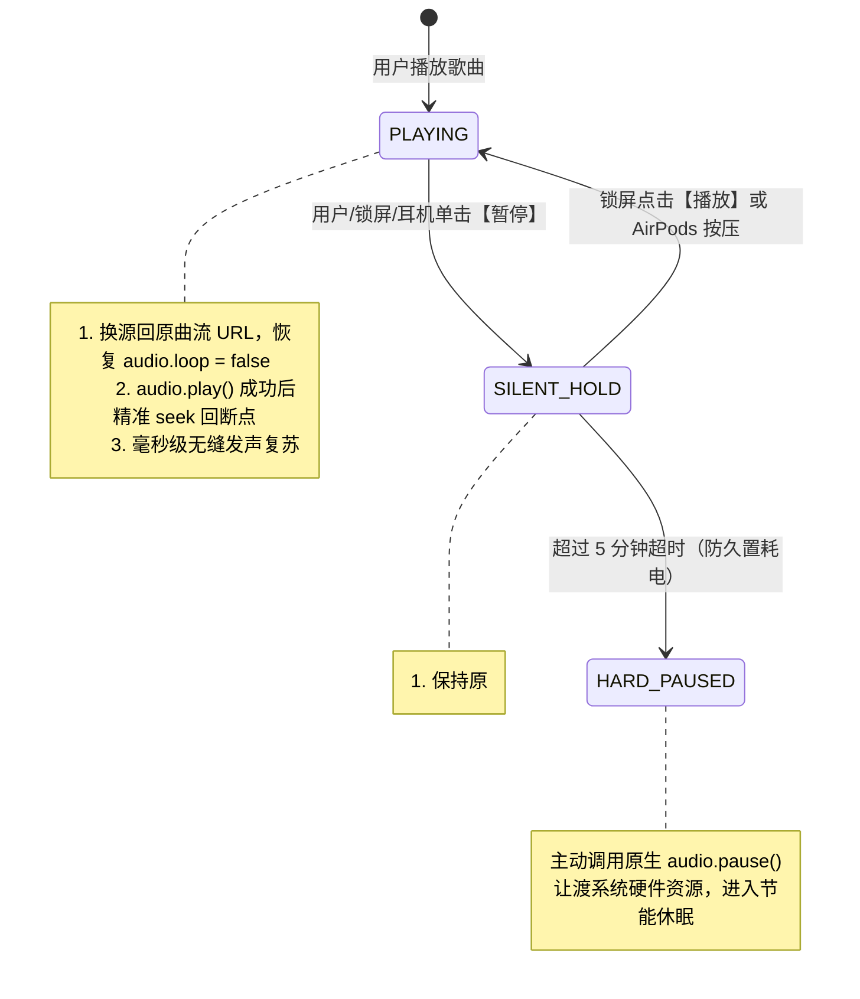

# 🎧 PWA Player (`@pwa-player/core`)

> **跨框架通用 PWA 音频播放器内核** — 彻底根治 iOS WebKit / Safari 锁屏后台暂停假走针死锁、硬件解码器回收、静音封面蒸发与 AirPods 反向按压难题。

[](LICENSE)
[](#examples)
[](#core-architecture-mode-f3)

---

## 💡 为什么需要 PWA Player？

在 iOS Mobile Safari 和 PWA（独立全屏模式 Standalone）中，使用 HTML5 `<audio>` 播放音乐一直存在几个令 Web 开发者痛苦万分的**系统级深水区顽疾**：

| 顽疾现象 | 触发场景 | 底层系统根因 | 传统播放器表现 | PWA Player (Mode F3) |
| :--- | :--- | :--- | :--- | :--- |
| **假走针死锁 (Fake Progress)** | 锁屏暂停超过 5~15 秒后再按播放 | iOS 保护期过后单方面注销并回收该 `<audio>` 绑定的底层 **CoreAudio PCM 硬件解码槽** | UI 进度条往前空跑，耳机无声，`currentTime` 冻结 | **✅ 毫秒级瞬时出声恢复** |
| **锁屏封面歌名蒸发** | 暂停时使用 `muted = true` 试图软暂停 | WebKit 官方源码 `canShowControlsManager()` 命中静音硬拦截，当场剥夺 NowPlaying 资格 | 锁屏卡片直接消失被 Apple Music 顶替 | **✅ 保持原曲 Metadata 钉死不丢** |
| **AirPods 按压唤醒失效** | 耳机按压单击暂停后再按压播放 | 底层有发声流时，iOS 守护进程倾向下发反向 `action: "pause"` 导致死循环 | 怎么按都没有反应或越按越死 | **✅ 智能翻转状态机（Flip-Flop）顺滑唤醒** |
| **切歌/连播死锁** | 播放完自动下一首或锁屏点切歌 | 切歌时若经过 `await fetch()` 异步网络请求，**用户手势信任链（User Gesture Context）**瞬间失效，系统抛出 `NotAllowedError` | 锁屏切歌看似切了但完全无声 | **✅ 双向周边并发预热，零异步同步切换** |
| **锁屏跳秒键冲刷** | 熄屏控制中心 | 在 `timeupdate` 中每秒多次调用 `setPositionState`，导致跨进程 IPC 冲刷使系统重置回 `«15 15»` 跳秒布局 | 锁屏只能跳 15 秒，没有上一首/下一首 | **✅ 显式封死跳秒，低频事件驱动原生 ⏮ ⏯ ⏭ 音乐布局** |

---

## 🛡️ 核心架构原理：Mode F3 单轨换源保活

Mode F3 是专为攻克 iOS WebKit 硬件死锁而生的音频管线架构：



---

## 📦 项目结构

```
~/dev/pwa-player/
├── packages/
│   └── core/                    # @pwa-player/core（零外部 UI 依赖纯 TypeScript 核心内核）
│       ├── src/
│       │   ├── player.ts        # PwaPlayer 顶层引擎
│       │   ├── keepAlive.ts     # Mode F3 单轨换源保活控制器
│       │   ├── mediaSession.ts  # MediaSession 规范化与锁屏沉浸歌词
│       │   ├── playlist.ts      # 播放列表状态机 (loop/sequence/single/shuffle)
│       │   ├── gesture.ts       # 手势链双向并发预热保护器
│       │   ├── lyric.ts         # LRC 歌词解析与 Diff 节流
│       │   └── silentWav.ts     # 内存 2s 0 振幅静音 PCM WAV 发生器
├── demo-assets/                 # 自带 3 首原创无版权测试音频 (12~14s 快速验证连播)
│   ├── track1.wav               # Neon Horizon (12s, CC0)
│   ├── track2.wav               # Morning Mist (14s, CC0)
│   ├── track3.wav               # Starlight Serenade (12s, CC0)
│   └── demoTracks.ts            # 带 LRC 歌词的示例清单
└── examples/                    # 各框架独立演示 Demo
    ├── vanilla/                 # 纯原生 Vanilla JS / TS Demo
    ├── react/                   # React 18 Demo (含 usePwaPlayer Hook)
    ├── vue/                     # Vue 3 Demo (含 usePwaPlayer Composable)
    └── svelte/                  # Svelte 5 Demo (含 Runes 响应式状态)
```

---

## 🚀 快速使用

### 1. 核心安装
```bash
npm install @pwa-player/core
# or
pnpm add @pwa-player/core
```

### 2. 纯 Vanilla TS 使用
```typescript
import { createPwaPlayer } from '@pwa-player/core';

const player = createPwaPlayer({
  initialQueue: [
    {
      id: 1,
      title: 'Neon Horizon',
      artist: 'Synthwave Echoes',
      src: '/demo-assets/track1.wav',
      artwork: '/demo-assets/cover1.svg',
      duration: 12
    }
  ],
  keepAlive: {
    strategy: 'auto',              // iOS 自动激活 F3 保活，桌面/Android 原生 pause
    hardPauseTimeoutMs: 5 * 60 * 1000 // 5 分钟超时自动真暂停节能
  },
  preloadAdjacent: true,           // 双向预热前后曲目，杜绝切歌 NotAllowedError
  enforceTrackNavigation: true,    // 封死 15s 跳秒，维持原生音乐控制卡片
  enableLockscreenLyrics: true     // 锁屏实时滚动歌词
});

// 状态订阅 (框架无关)
player.subscribe((state) => {
  console.log(state.currentTrack, state.isPlaying, state.currentTime);
});

// 播控方法
player.toggle();
player.next();
player.prev();
player.seek(15.5);
```

### 3. React 18 / 19 (`usePwaPlayer`)
```tsx
import { usePwaPlayer } from './usePwaPlayer';

export default function MusicPlayer() {
  const { state, toggle, next, prev, seek } = usePwaPlayer({
    initialQueue: myTracks,
    keepAlive: { strategy: 'auto' }
  });

  return (
    <div>
      <h3>{state.currentTrack?.title}</h3>
      <button onClick={toggle}>{state.isPlaying ? '暂停' : '播放'}</button>
      <button onClick={next}>下一首</button>
    </div>
  );
}
```

### 4. Vue 3 (`usePwaPlayer`)
```vue
<script setup>
import { usePwaPlayer } from './usePwaPlayer';

const { state, toggle, next, prev } = usePwaPlayer({
  initialQueue: myTracks,
  keepAlive: { strategy: 'auto' }
});
</script>

<template>
  <div>
    <h3>{{ state.currentTrack?.title }}</h3>
    <button @click="toggle">{{ state.isPlaying ? '暂停' : '播放' }}</button>
    <button @click="next">下一首</button>
  </div>
</template>
```

### 5. Svelte 5 (Runes)
```svelte
<script lang="ts">
  import { createSveltePlayer } from './playerStore.svelte';

  const player = createSveltePlayer({
    initialQueue: myTracks,
    keepAlive: { strategy: 'auto' }
  });

  const state = $derived(player.state);
</script>

<div>
  <h3>{state.currentTrack?.title}</h3>
  <button onclick={player.toggle}>{state.isPlaying ? '暂停' : '播放'}</button>
  <button onclick={player.next}>下一首</button>
</div>
```

---

## 🧪 启动本地 Demo 进行测试

本仓库自带免版权测试音乐（每首约 12~14 秒，无需等待数分钟即可快速验证自动连播与锁屏交互）：

```bash
cd ~/dev/pwa-player

# 1. 安装所有依赖
pnpm install

# 2. 构建核心库
pnpm build:core

# 3. 运行对应的演示项目（支持局域网真机访问，例如手机 Safari）
pnpm dev:vanilla   # 运行原生 Demo (端口 5173)
pnpm dev:react     # 运行 React Demo (端口 5174)
pnpm dev:vue       # 运行 Vue 3 Demo (端口 5175)
pnpm dev:svelte    # 运行 Svelte 5 Demo (端口 5176)
```

### 📱 手机 Safari / iOS PWA 核心测试 Checklist：
1. **锁屏切歌与控制中心**：点击播放后按电源键熄屏，查看锁屏是否显示原生 **⏮ 播放/暂停 ⏭** 音乐卡片（而非 `«15 15»` 跳秒）；
2. **熄屏连播**：放任歌曲播放完毕（约 12 秒），验证熄屏后台下是否顺畅**自动推进到下一首**；
3. **熄屏暂停与秒级唤醒（核心死锁测试）**：
   - 在锁屏界面点击【暂停】或按压 AirPods；
   - **将手机静置黑屏 20~30 秒**（足以让 iOS 睡眠并单方面注销普通播放器的硬件解码器）；
   - 再次点击【播放】或按压 AirPods：**声音瞬时恢复发声，进度平滑向前，杜绝假走针死锁！**

---

## 📄 License
MIT © 2026 PWA Player Contributors
