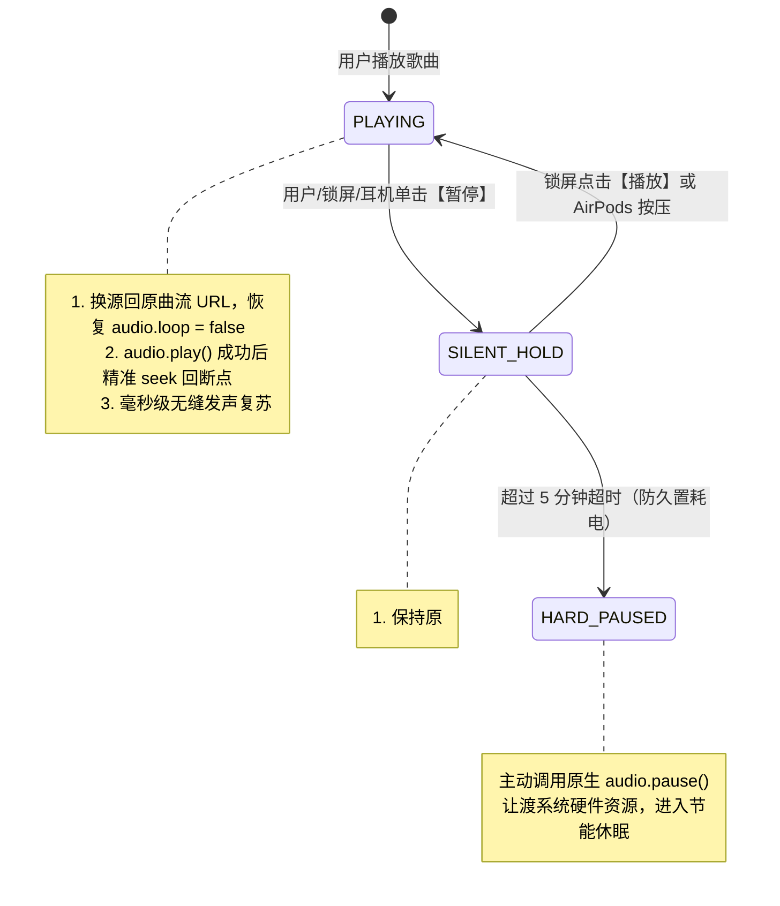

# 🎧 PWA Audio Player (`pwa-audio-player`)

> **跨框架通用 PWA 音频播放器内核** — 彻底根治 iOS WebKit / Mobile Safari 锁屏后台暂停假走针死锁、硬件解码器回收、静音封面蒸发与 AirPods 反向按压难题。

<p align="center">
  <a href="./README.md"><b>English</b></a> |
  <a href="./README.zh-CN.md"><b>简体中文</b></a> |
  <a href="./README.ja.md"><b>日本語</b></a>
</p>

[](LICENSE)
[](https://www.npmjs.com/package/pwa-audio-player)
[](https://pwa-audio-player.pages.dev)
[](#framework-demos)
[](#core-architecture)

---

## 💡 为什么需要 PWA Audio Player？

在 iOS Mobile Safari 和 PWA（独立全屏模式 Standalone）中，使用标准 HTML5 `<audio>` 播放音乐一直存在几个令 Web 开发者痛苦万分的**系统级深水区顽疾**：

| 顽疾现象 | 触发场景 | 底层系统根因 | 传统播放器表现 | PWA Player (单轨静音保活) |
| :--- | :--- | :--- | :--- | :--- |
| **假走针死锁 (Fake Progress)** | 锁屏暂停超过 5~15 秒后再按播放 | iOS 为节电在 3~5 秒后单方面注销并回收该 `<audio>` 绑定的底层 **CoreAudio PCM 硬件解码槽** | UI 进度条往前空跑，耳机无声，`currentTime` 冻结 | **✅ 毫秒级瞬时出声恢复** |
| **锁屏封面歌名蒸发** | 暂停时使用 `muted = true` 试图软暂停 | WebKit 源码 `canShowControlsManager()` 命中静音硬拦截，当场剥夺 NowPlaying 资格 | 锁屏卡片直接消失被 Apple Music 顶替 | **✅ 保持原曲 Metadata 钉死不丢** |
| **AirPods 按压唤醒失效** | 耳机按压单击暂停后再按压播放 | 底层有发声流时，iOS 守护进程倾向下发反向 `action: "pause"` 导致死循环 | 怎么按都没有反应或越按越死 | **✅ 智能翻转状态机（Flip-Flop）顺滑唤醒** |
| **切歌/连播死锁** | 播放完自动下一首或锁屏点切歌 | 切歌时若经过 `await fetch()` 异步网络请求，**用户手势信任链（User Gesture Context）**瞬间失效，系统抛出 `NotAllowedError` | 锁屏切歌看似切了但完全无声 | **✅ 双向周边并发预热，零异步同步切换** |
| **锁屏跳秒键冲刷** | 熄屏控制中心 | 在 `timeupdate` 中每秒多次调用 `setPositionState`，导致跨进程 IPC 冲刷使系统重置回 `«15 15»` 跳秒布局 | 锁屏只能跳 15 秒，没有上一首/下一首 | **✅ 显式封死跳秒，低频事件驱动原生 ⏮ ⏯ ⏭ 音乐布局** |

---

## 🛡️ 核心技术架构：单轨静音换源保活 (Single-Track Silent Hold)

### 为什么“双音轨”或“Web Audio 振荡器”不管用？
- iOS 会为每一个独立的 `HTMLMediaElement` 实例分配专属的硬件解码通道。一旦主音频元素调用了 `audio.pause()`，即使副音轨在播放声音，主音轨对应的 CoreAudio 硬件解码器依然会在数秒后被系统单方面销毁；
- Web Audio API (`AudioContext`) 在屏幕熄灭数秒后会被 WebKit 强行挂起（`state -> suspended`）。

### PWA Player 的解决方案
保持**同一个 `<audio>` 实例永不调用 `pause()`**：



---

## 🎮 多框架演示套件 (Demos)

在 `examples/` 目录下提供了完整的跨框架演示与专属主题：

- **Hub 导航中心** (`:5170`): 跨框架一览、局域网测试节点与测试指南。
- **Vanilla TS** (`:5173`): 琥珀金主题，纯原生 DOM，零第三方框架。
- **React 18 / 19** (`:5174`): 天空蓝主题，内置 `usePwaPlayer` 自定义 Hook。
- **Vue 3** (`:5175`): 翡翠绿主题，组合式 API 与 `shallowRef` 直连。
- **Svelte 5** (`:5176`): 焰火橙主题，基于 Svelte 5 Runes (`$state`, `$derived`) 实现。

### 本地启动演示
```bash
git clone https://github.com/ajaxsys/pwa-audio-player.git
cd pwa-audio-player
pnpm install
pnpm dev:demos
```
手机与电脑处于同一 Wi-Fi 时，直接扫描终端输出的二维码即可在真机 Safari 上体验。

---

## 🚀 快速上手

### 安装
```bash
npm install pwa-audio-player
# or
pnpm add pwa-audio-player
```

### 基础调用 (TypeScript / 原生)
```typescript
import { createPwaPlayer } from 'pwa-audio-player';

const player = createPwaPlayer({
  initialQueue: [
    {
      id: 1,
      title: 'Neon Horizon',
      artist: 'Synthwave Echoes',
      album: 'Cyber Odyssey',
      src: 'https://example.com/audio1.mp3',
      artwork: 'https://example.com/cover1.jpg',
      duration: 180,
      lrc: '[00:00.00]Synthesizer starts...'
    }
  ],
  keepAlive: {
    strategy: 'auto',              // iOS 下自动启用静音保活，其他系统走原生 Pause
    hardPauseTimeoutMs: 5 * 60 * 1000 // 5 分钟超时防耗电保活退避
  },
  preloadAdjacent: true,           // 双向预热周边音轨，保护 iOS 用户手势链
  enableLockscreenLyrics: true     // 同步锁屏 MediaSession 动态歌词
});

// 播放控制
player.play();
player.toggle();
player.next();

// 状态订阅
const unsubscribe = player.subscribe((state) => {
  console.log('播放状态:', state.playbackState, '当前进度:', state.currentTime);
});
```

---

## 🧩 微模块工具链与独立开发配方 (Modular Recipes)

不想使用开箱即用的整包播放器？`pwa-audio-player` 内部的所有底层原子能力**均支持独立导入与 Tree-Shaking**。你可以自由将其按需组装进已有的 React、Vue、Svelte、Redux、Pinia、Zustand 或自定义原生 `<audio>` 播放器体系中：

### 1. ⏱️ 锁屏时钟防漂移睡眠定时器 (`SleepTimerController`)
即使在 iOS 锁屏后台定时器被系统暴力节流的极端环境下，依然通过绝对时间戳与音频帧对齐校准，支持“播完当前歌曲后停止”与彻底释放硬件解码器。

```typescript
import { SleepTimerController } from 'pwa-audio-player';

const timer = new SleepTimerController({
  onTimerEnd: () => {
    // 关机销毁保活并暂停释放硬件解码器
    audioElement.pause();
    console.log('定时已到，音频停止播放');
  },
  onTick: (remainingSeconds) => {
    console.log(`剩余倒计时: ${remainingSeconds}秒`);
  }
});

// 开启 30 分钟倒计时
timer.setPreset(30);

// 或开启“播完当前歌曲后自动停止”模式
timer.setEndOfTrack(true);

// 结合音频播放事件校准时钟，防止 iOS 锁屏后台休眠漂移
audioElement.addEventListener('timeupdate', () => {
  timer.checkTick();
});
```

### 2. 🌐 Service Worker HTTP Range 206 切片响应 (`swAudio`)
彻底攻克 Service Worker 拦截音频离线缓存后，iOS Safari 锁屏进度条拖拽无法 seek / 假死的系统级网络栈深坑：

```javascript
// 在你的 sw.js 中
import { createPartialResponse, isAudioRequest } from 'pwa-audio-player';

self.addEventListener('fetch', (event) => {
  if (isAudioRequest(event.request.url)) {
    event.respondWith((async () => {
      const cache = await caches.open('my-audio-cache');
      const cached = await cache.match(event.request);
      if (cached) {
        const rangeHeader = event.request.headers.get('Range');
        // 自动基于 Blob.slice 构造包含 Content-Range 与 Accept-Ranges 的标准 206 响应
        return createPartialResponse(cached, rangeHeader);
      }
      return fetch(event.request);
    })());
  }
});
```

### 3. 💾 离线音频流缓存管理器 (`AudioCacheStorage`)
基于浏览器标准 CacheStorage 的全功能音频离线管理器，包含存储配额容量探测与播放频次统计：

```typescript
import { AudioCacheStorage, queryStorageQuota } from 'pwa-audio-player';

const audioCache = new AudioCacheStorage({
  cacheName: 'app-audio-v1',
  storageKeyPrefix: 'my_app_audio_'
});

// 将远程流异步持久化到浏览器 CacheStorage
await audioCache.cacheTrack('track_101', 'https://cdn.example.com/song.mp3');

// 查询某首曲目是否支持断网离线秒播
const isAvailableOffline = await audioCache.isCached('track_101');

// 查询浏览器当前已用容量与剩余配额
const { usageMB, quotaMB, percent } = await queryStorageQuota();
console.log(`缓存已用: ${usageMB}MB / ${quotaMB}MB (${percent}%)`);
```

### 4. 📜 游标安全队列状态机 (`PlaylistManager`)
自带“下一首插播 (Play Next)”、拖拽调序、移除曲目并具备当前播放游标边界保护的队列状态机，附带纯函数 Fisher-Yates 洗牌：

```typescript
import { PlaylistManager, shuffleArray } from 'pwa-audio-player';

const pm = new PlaylistManager(myTracks, 0, 'sequence');

// 在当前正在播放的曲目后立即插播下一首
pm.insertNext(newSong);

// 将第 4 项移动到第 1 项，内部自动重定向当前曲目指针，保障播放不中断
pm.move(4, 1);

// 安全删除某一曲目（自动修正越界与游标前移）
pm.remove(2);

// 非破坏性无副作用数组乱序洗牌
const shuffled = shuffleArray(myTracks);
```

### 5. 🎵 二分查找极速歌词解析器 (`parseLrc`, `getActiveLyric`)
零 DOM、纯数学 $O(\log N)$ 歌词解析与二分检索器，完美应对拖拽进度条时的 60fps 密集刷新：

```typescript
import { parseLrc, getActiveLyric } from 'pwa-audio-player';

const lyrics = parseLrc(`
  [00:00.00]前奏
  [00:15.5]单小数支持
  [01:00.00][01:30.00]副歌重复两遍
`);

// 在 ontimeupdate 或 60fps rAF 中高频调用，仅需 ~7 次比较即刻命中
const active = getActiveLyric(lyrics, currentAudioTime);
console.log(active.currentText); // 当前行歌词
console.log(active.nextText);    // 下一行预告
console.log(active.index);       // 当前高亮行下标（供驱动列表滚动）
```

### 6. 🎨 封面像素级主辅色提取器 (`extractCoverPalette`)
基于离屏 Canvas 像素量化与 HSL 饱和度过滤，自动为播放器背景生成高颜值自适应渐变主题：

```typescript
import { extractCoverPalette } from 'pwa-audio-player';

const palette = await extractCoverPalette('https://example.com/cover.jpg');
// {
//   dominant: '#1a1f2c',
//   accent: '#e24a4a',
//   isDark: true,
//   gradient: 'linear-gradient(135deg, #1a1f2c 0%, #0d1017 100%)'
// }
```

### 7. 🎚️ 参数均衡器插值曲线引擎 (`calculatePeqCurve`)
10 段 PEQ 样条插值计算引擎，内置多种常见声学听感预设（Rock, Pop, Jazz 等）：

```typescript
import { calculatePeqCurve, BUILTIN_PRESETS, INITIAL_BANDS } from 'pwa-audio-player';

// 获取摇滚预设增益数组
const bands = BUILTIN_PRESETS['Rock'];

// 计算输出 128 个平滑插值点坐标，直接绑定给 SVG <path> 或 Canvas
const points = calculatePeqCurve(bands, 128);
```
```

---

## 📱 iOS 真机测试步骤

1. iPhone Safari 中点击播放，按电源键进入锁屏状态；
2. 检查锁屏界面是否正常展示高清封面、歌词与切歌按键；
3. 在锁屏卡片或通过 AirPods 按压暂停，等待 20~30 秒让系统进入深度睡眠；
4. 再次点击播放：毫秒级瞬时恢复出声，彻底消除假走针死锁；
5. 让歌曲自然完播，验证熄屏下链式连播是否稳定。

---

## 📄 开源许可

MIT License © 2026 [ajaxsys](https://github.com/ajaxsys)

